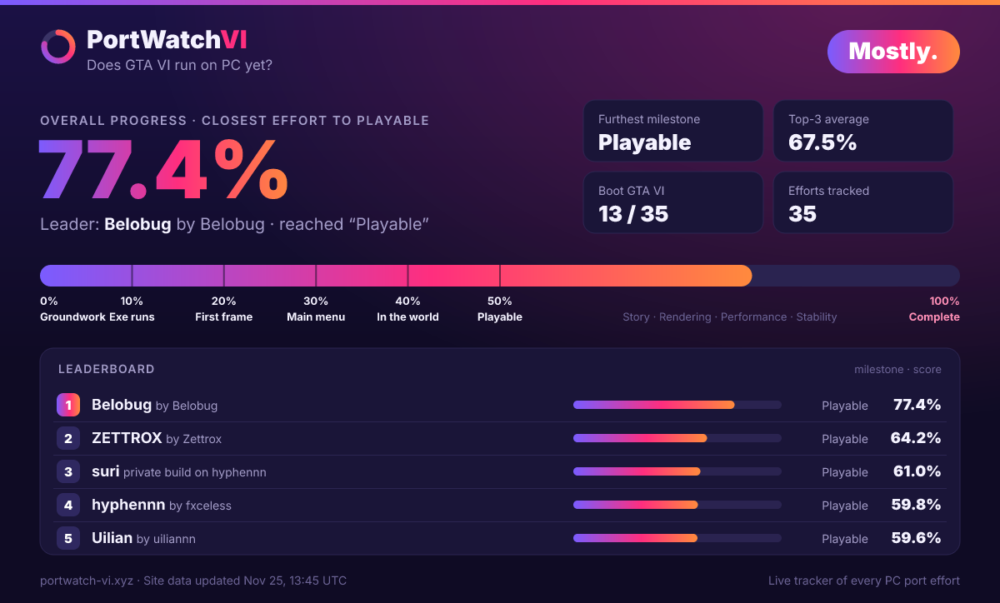

# PortWatcher

PortWatcher is an unofficial Discord bot for [PortWatch VI](https://portwatch-vi.xyz/), the live tracker of every effort to run
GTA VI on PC. It keeps a **live progress widget** in a channel of your choice and refreshes it every 30 seconds.
It works on as many servers as you like: each server sets up its own channels with slash commands.



> Not affiliated with PortWatch VI. All data comes from the public site.

## Add the bot to your server

Don't want to host it yourself? Invite the hosted PortWatcher:

**[➕ Add PortWatcher to Discord](https://discord.com/oauth2/authorize?client_id=1575156681409560737&scope=bot+applications.commands&permissions=117760)**

Then run `/widget setup #channel` in your server. You need the *Manage Server* permission for that.
To run your own copy instead, see [Quick start](#quick-start).

## Features

- **Live widget**: overall progress, the leader, the milestone ladder, key stats and the top 5, drawn as an image,
  plus an embed with a "last checked" time. It refreshes every 30 seconds. The image is only re-uploaded when the data changed.
- **Latest updates** (can be turned off per server): a second embed under the widget with the latest news articles or the
  tracker's changelog (score changes, newly spotted efforts, claims).
- **Alerts** (optional): a post, with an optional role ping, when there's a new leader, a new milestone,
  a new answer to "Does GTA VI run on PC yet?" or a new article.
- **Same numbers as the site**: the site's scoring code (`scoring.js`) is ported to Rust and fed from its `data/tracker.json`.
- Recovers by itself: a deleted widget is posted again. If the bot loses access, the widget pauses and `/settings` shows why.
- One static binary with fonts built in. No database: settings live in a JSON file.

## Commands

| Command | Who | What it does |
|---|---|---|
| `/widget setup #channel` | Manage Server | Post the live widget in a channel (replaces an existing one) |
| `/widget updates <show> [count]` | Manage Server | Latest updates under the widget: `News articles` (default), `Tracker changelog` or `Off`; 1 to 5 entries (default 3) |
| `/widget repost` | Manage Server | Post the widget again at the bottom of its channel |
| `/widget remove` | Manage Server | Remove the widget |
| `/alerts setup #channel [@role]` | Manage Server | Turn on alerts, optionally pinging a role |
| `/alerts disable` | Manage Server | Turn off alerts |
| `/settings` | Manage Server | Show this server's settings and any problems |
| `/progress [private]` | Everyone | Show the current progress image |
| `/leaderboard [count]` | Everyone | Show the top efforts (3–25) |
| `/help` | Everyone | List the commands |

Admins can change who may use which command under *Server Settings → Integrations*.

## Quick start

1. Create an application at <https://discord.com/developers/applications>, open **Bot**, and copy the token
   (**Reset Token**). The bot needs no privileged intents.
2. Run the bot (see below). On start it prints the **invite link** in the console:
   ```
   Invite link: https://discord.com/oauth2/authorize?client_id=…&scope=bot+applications.commands&permissions=117760
   PortWatcher is online as PortWatcher#1234 in 0 server(s)
   ```
   That's View Channels, Send Messages, Embed Links, Attach Files and Read Message History.
3. Invite the bot, then run `/widget setup #channel` in your server.

The first time, global slash commands can take a few minutes to appear. Set `DEV_GUILD_ID` to register them in one test server straight away.

### Pterodactyl

1. Download [`egg/egg-portwatch-vi-bot.json`](egg/egg-portwatch-vi-bot.json) (it's also attached to every release).
2. In the admin panel go to **Nests → Import Egg**, pick the file and choose a nest.
3. Create a server with the **PortWatcher** egg. It needs very little: 128 MB RAM and 100 MB disk are plenty.
4. On the **Startup** tab, set **Discord Bot Token**. Everything else has sensible defaults:

   | Variable | Default | |
   |---|---|---|
   | Discord Bot Token | | Required |
   | Update Interval (seconds) | `30` | Minimum 10 |
   | Dev Server ID | | Register commands in one server only |
   | Auto Update | `1` | Download the selected release on every start |
   | Release Version | `latest` | Or a tag like `v0.1.0` |
   | Log Level | `info,serenity=warn,poise=warn` | |
   | Tracker URL | `https://portwatch-vi.xyz/data/tracker.json` | |

5. Start the server. Copy the invite link from the console.

The egg installs the static binary for x86_64 or ARM64 from GitHub Releases and checks its SHA-256.
Settings are kept in `data/guilds.json` on the server.

### Linux binary

```sh
curl -fsSL -o portwatch-bot https://github.com/wildesPepega/portwatch-vi-discord-bot/releases/latest/download/portwatch-bot-x86_64-linux
chmod +x portwatch-bot
DISCORD_TOKEN=your-token ./portwatch-bot
```

For ARM64, use `portwatch-bot-aarch64-linux`. The binaries are fully static (musl), so they run on any Linux.

### From source

```sh
git clone https://github.com/wildesPepega/portwatch-vi-discord-bot
cd portwatch-vi-discord-bot
cp .env.example .env    # put your token in DISCORD_TOKEN
cargo run --release
```

To render the widget image without connecting to Discord, run `cargo run --release -- --preview preview.png`.

## Configuration

Set these as environment variables or in a `.env` file:

| Variable | Default | |
|---|---|---|
| `DISCORD_TOKEN` | (required) | Bot token |
| `UPDATE_INTERVAL_SECS` | `30` | Refresh interval (minimum 10) |
| `DEV_GUILD_ID` | | Register commands in this server only |
| `DATA_FILE` | `data/guilds.json` | Where per-server settings are stored |
| `TRACKER_URL` | `https://portwatch-vi.xyz/data/tracker.json` | Data source |
| `RUST_LOG` | `info,serenity=warn,poise=warn` | Log filter |

## How it works

```
src/
├── tracker.rs   fetch tracker.json, port of the site's scoring.js
├── render.rs    widget image: SVG → PNG with resvg
├── widget.rs    30-second loop, widget and updates embeds, alerts
├── commands.rs  slash commands (poise)
├── store.rs     per-server settings (JSON, written atomically)
└── main.rs      startup, invite link, events
```

Every 30 seconds the bot fetches the tracker once and scores it. It renders the image only if what the image shows has changed,
then edits each server's widget message (eight at a time, within Discord's rate limits).

## Releases

Pushing a tag `vX.Y.Z` builds static binaries for x86_64 and aarch64 Linux and publishes a GitHub release
with SHA-256 checksums and the Pterodactyl egg.

## License

[MIT](LICENSE). The bundled [Inter](https://rsms.me/inter/) font is under the SIL Open Font License, see
[`assets/fonts/OFL-LICENSE.txt`](assets/fonts/OFL-LICENSE.txt).
